<!-- 🔦 ARQUIVO H.M. — CABEÇALHO -->

  

<!-- 🗂️ DOSSIÊ -->

  

<!-- 🧵 CRONOLOGIA DO CASO -->

  

<!-- 🧪 PROVAS COLETADAS -->

  

<!-- 📁 CASOS INVESTIGADOS -->

  <a href="https://github.com/HellenMayara/calculadora"></a>
  <a href="https://github.com/HellenMayara/lista-de-tarefas"></a>

  <a href="https://github.com/HellenMayara/conversor-de-moedas"></a>
  

  <a href="https://github.com/HellenMayara/analisador-avaliacoes-ia"></a>

<!-- 🔬 RELATÓRIO DA PERÍCIA (gerado sozinho pelo GitHub Actions, ver .github/workflows/pericia.yml) -->

  
  

<!-- 📞 CONTATO -->
<h3 align="center">Tem uma pista? Fale com a investigada</h3>

  
  

<!-- 🌑 RODAPÉ -->

  

